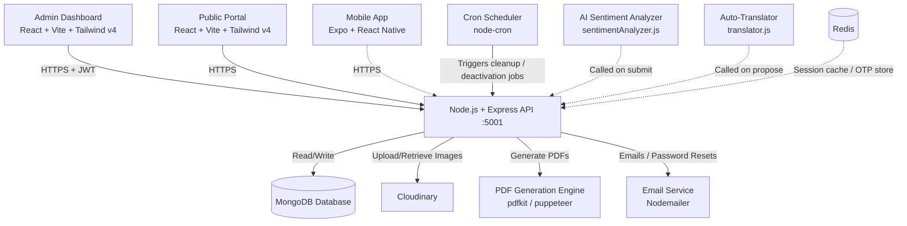

# iBOSys Architecture and Database Design

This document details the software architecture, database design, schema definitions, and API specifications for the **iBOSys** platform.

**Last Updated**: September 2026 — Design system unification complete (Tailwind v4 + shared UI packages), OpenAPI spec synced, CI workflow added, security hardening (Helmet, rate-limiting, CORS restricted), system routes cleaned, Redis integrated, Cloudinary for uploads, mobile app scaffolded.

---

## 1. System Architecture Diagram



*   **Client (Admin)**: SPA built using React 19, Vite 6, Tailwind CSS v4, shadcn/ui-style components. Communicates with API using JWT tokens in `Authorization: Bearer` header. All mutation requests validated by Zod schemas server-side.
*   **Client (Public Portal)**: Standalone React + Vite + Tailwind v4 application for citizens to view records and participate in consultations. Shares design tokens and UI components via `@ibosys/design-tokens` and `@ibosys/ui` packages.
*   **Mobile App**: Expo + React Native scaffold (React 19, Expo SDK 57). Consumes `/api/public/*` endpoints. API URL via `EXPO_PUBLIC_API_URL` env var.
*   **Server**: RESTful API on Node.js/Express (port 5001). Secured routes under `/api/`, public routes under `/api/public/`. CORS restricted to configured `FRONTEND_URL` and `PORTAL_URL` (localhost allowed only in development). Helmet security headers, express-rate-limit on auth/public endpoints. Zod validation middleware on all mutations (Laravel FormRequest style).
*   **Database**: MongoDB (Mongoose ODM). Compound unique indexes on `ConsultationFeedback` for DPA compliance.
*   **Storage**: Cloudinary for all image uploads (SB member photos, announcement covers, user avatars, guest consultation ID images). Local `uploads/` directory **not used** in production — multer uses `memoryStorage()`.
*   **Authentication**: JWT (HS256) stored as Bearer headers. `protect` + `authorize` middleware for role-based access.
*   **OTP Store**: Redis with TTL (production) / in-memory Map (development fallback).
*   **Sentiment Analysis**: Pure JavaScript keyword-matching utility (`sentimentAnalyzer.js`). Secretary can override during verification.
*   **Translation**: `translator.js` auto-translates ordinance titles and plain language summaries to Tagalog on proposal.
*   **Background Cron Jobs**: Node-cron schedules daily midnight jobs (Asia/Manila timezone): `termDeactivator.js` (expired term deactivation) and `idCleaner.js` (DPA-compliant ID image cleanup after 30 days).
*   **Shared Packages**: `@ibosys/design-tokens` (191 CSS custom properties), `@ibosys/ui` (17 shared React components: Card, Button, Badge, Modal, StatCard, etc.).
*   **API Documentation**: Hand-maintained OpenAPI 3.0.3 spec at `docs/openapi.yaml` (synced with actual routes).
*   **CI/CD**: GitHub Actions workflow (`.github/workflows/ci.yml`) runs build, lint, test across all packages, verifies token definitions in compiled CSS, runs dependency audits.

---

## 2. Database Schema (MongoDB Mongoose)

### 2.1 User Schema (`users` collection)
```javascript
const UserSchema = new Schema({
  name: { type: String, required: true, trim: true },
  email: { type: String, required: true, unique: true, lowercase: true, trim: true },
  password: { type: String, required: true },
  role: { 
    type: String, 
    enum: ['System Admin', 'Secretary', 'Vice Mayor', 'SB Member'], 
    required: true 
  },
  contactNumber: { type: String, required: true },
  status: { 
    type: String, 
    enum: ['Pending', 'Active', 'Deactivated'], 
    default: 'Active'
  },
  position: { 
    type: String, 
    required: function() { return ['Vice Mayor', 'SB Member'].includes(this.role); } 
  },
  termStart: { type: Date },
  termEnd: { type: Date },
  mustChangePassword: { type: Boolean, default: false },
  profilePicture: { type: String, default: '' },
  idImageUrl: { type: String, default: '' },
  pendingVote: {
    ordinanceId: { type: Schema.Types.ObjectId, ref: 'Ordinance' },
    vote: { type: String },
    text: { type: String }
  }
}, { timestamps: true });
```

### 2.2 Ordinance Schema (`ordinances` collection)
> This collection stores **both Ordinances and Resolutions**, distinguished by the `type` field.

```javascript
const OrdinanceSchema = new Schema({
  number: { type: String, required: true, unique: true, trim: true },
  title: { type: String, required: true, trim: true },
  title_tl: { type: String }, // Auto-translated Tagalog title
  // proponentId references the SBMember collection (NOT User)
  proponentId: { type: Schema.Types.ObjectId, ref: 'SBMember', required: true },
  termId: { type: Schema.Types.ObjectId, ref: 'Term' },  // Legislative term reference
  committee: { type: String, required: true },
  sectorTag: { type: String, default: 'General' },
  type: { type: String, enum: ['Ordinance', 'Resolution'], default: 'Ordinance' },
  explanatoryNote: { type: String, required: true },
  enactingClause: { type: String },
  provisions: { type: String, required: true }, // Rich HTML text from RichTextEditor
  penaltyClause: { type: String },
  effectivityDate: { type: Date },
  pdfUrl: { type: String },
  status: {
    type: String,
    enum: [
      'First Reading',        // Initial status when proposed
      'Committee Assignment',
      'Committee Hearing',    // Skipped for Resolutions
      'Public Consultation',  // Skipped for Resolutions
      'Second Reading',
      'Third Reading',
      "For Mayor's Signature",
      'For SP Review',
      'Approved'
    ],
    default: 'First Reading'
  },
  plainLanguageSummary: { type: String },
  plainLanguageSummary_tl: { type: String }, // Auto-translated
  isLocked: { type: Boolean, default: false },
  amendsOrdinanceId: { type: Schema.Types.ObjectId, ref: 'Ordinance', default: null },
  amendedByOrdinanceId: { type: Schema.Types.ObjectId, ref: 'Ordinance', default: null },
  // Dynamic sections
  sections: [{
    title: { type: String },
    content: { type: String }
  }],
  // Committee Hearing Report (created by Secretary)
  committeeReport: {
    findings: { type: String },
    recommendation: { type: String },
    viceSecretaryName: { type: String },
    createdAt: { type: Date },
    createdBy: { type: Schema.Types.ObjectId, ref: 'User' }
  },
  timeline: [{
    status: { type: String, required: true },
    notes: { type: String },
    updatedBy: { type: Schema.Types.ObjectId, ref: 'User', required: true },
    date: { type: Date, default: Date.now }
  }]
}, { timestamps: true });
```

### 2.3 SBMember Schema (`sbmembers` collection)
This is the **master list of elected and appointed SB members**, separate from system login accounts. It is the source of the **Proponent** dropdown in the Propose Document form.

```javascript
const SBMemberSchema = new Schema({
  firstName: { type: String, required: true, trim: true },
  middleName: { type: String, trim: true, default: '' },
  lastName: { type: String, required: true, trim: true },
  position: { type: String, required: true, trim: true }, // 'Vice Mayor', 'SB Member'
  photoUrl: { type: String, default: '' },
  biography: { type: String, default: '' },
  termId: { type: Schema.Types.ObjectId, ref: 'Term' }, // Legislative term reference
  committees: [{ type: String }],  // Committee assignment(s)
  termStart: { type: Date },
  termEnd: { type: Date },
  contactEmail: { type: String, default: '' },
  fbLink: { type: String, default: '' },
  sbNumber: { type: String, default: '' },
  order: { type: Number, default: 0 },         // Display order on Members page
  isActive: { type: Boolean, default: true }
}, { timestamps: true });

// Virtual `name` property computes the full name
SBMemberSchema.virtual('name').get(function() {
  if (this.middleName) return `${this.firstName} ${this.middleName} ${this.lastName}`;
  return `${this.firstName} ${this.lastName}`;
});
```

### 2.4 Term Schema (`terms` collection) ⭐
The **Term** model represents a legislative term of the Sangguniang Bayan. Ordinances, Resolutions, and SB Members are all categorized by term, enabling the public portal to filter content by the selected term.

```javascript
const TermSchema = new Schema({
  label: { type: String, required: true, trim: true, unique: true }, // e.g., "12th Sangguniang Bayan"
  startYear: { type: Number, required: true },
  endYear: { type: Number, required: true },
  description: { type: String, default: '' },
  presidingOfficer: { type: String, default: '' }, // Vice Mayor name for this term
  isCurrent: { type: Boolean, default: false }    // Only one term can be current at a time
}, { timestamps: true });

// Pre-save middleware: when isCurrent is set to true, all other terms are set to false
TermSchema.pre('save', async function(next) {
  if (this.isCurrent) {
    await this.constructor.updateMany({ _id: { $ne: this._id } }, { isCurrent: false });
  }
  next();
});
```

### 2.5 ConsultationFeedback Schema (`consultationfeedbacks` collection) ⭐
This is the **primary schema** for the Public Consultation system. It replaces the old separate `votes` and `comments` collections for guest submissions.

```javascript
const ConsultationFeedbackSchema = new Schema({
  ordinanceId: { type: Schema.Types.ObjectId, ref: 'Ordinance', required: true },
  full_name: { type: String, required: true, trim: true },
  barangay: { type: String, required: true, trim: true },
  contact_number: { type: String, required: true, trim: true },
  id_attachment_url: { type: String, required: true },
  vote: { type: String, enum: ['Agree', 'Disagree', 'Neutral', 'None'], default: 'None' },
  comment: { type: String, trim: true },
  status: { type: String, enum: ['Pending', 'Approved', 'Rejected'], default: 'Pending' },
  sentiment: { type: String, enum: ['Positive', 'Negative', 'Neutral'], default: 'Neutral' },
  approved_by: { type: Schema.Types.ObjectId, ref: 'User', default: null },
  approved_at: { type: Date, default: null }
}, { timestamps: true });

// Compound unique index — prevents duplicate submissions per ordinance
ConsultationFeedbackSchema.index(
  { ordinanceId: 1, full_name: 1, contact_number: 1 }, 
  { unique: true }
);
```

### 2.6 Committee Schema (`committees` collection)
```javascript
const CommitteeSchema = new Schema({
  name: { type: String, required: true, unique: true, trim: true },
  chairperson: { type: String, default: '' },
  viceChairperson: { type: String, default: '' },
  members: [{ type: String }],
  description: { type: String, default: '' },
  termId: { type: Schema.Types.ObjectId, ref: 'Term' }
}, { timestamps: true });
```
*Default committees are seeded on first access via `GET /api/committees` (11 committees for 2025-2028 term). Migration endpoint `POST /api/committees/migrate-2025` available for system admin.*

### 2.7 Session Schema (`sessions` collection)
```javascript
const SessionSchema = new Schema({
  title: { type: String, required: true, trim: true },
  date: { type: Date, required: true },
  itemsDiscussed: [{ type: Schema.Types.ObjectId, ref: 'Ordinance' }],
  createdBy: { type: Schema.Types.ObjectId, ref: 'User', required: true },
  // Attendance fields
  attendance: {
    present: [{ type: Schema.Types.ObjectId, ref: 'SBMember' }],
    onOfficialBusiness: [{ type: Schema.Types.ObjectId, ref: 'SBMember' }],
    absent: [{ type: Schema.Types.ObjectId, ref: 'SBMember' }]
  },
  // Rich-text session proceedings fields
  callToOrder: { type: String, default: '' },
  invocation: { type: String, default: '' },
  rollCall: { type: String, default: '' },
  readingOfPreviousMinutes: { type: String, default: '' },
  citizensHour: { type: String, default: '' },
  questionHour: { type: String, default: '' },
  committeeReport: { type: String, default: '' },
  // Reference of Business sub-sections
  firstReading: { type: String, default: '' },
  unfinishedBusiness: { type: String, default: '' },
  referralForAction: { type: String, default: '' },
  referralForReference: { type: String, default: '' },
  referenceOfBusiness: { type: String, default: '' }, // Legacy fallback
  otherMatters: { type: String, default: '' },
  thanksgivingPrayer: { type: String, default: '' },
  adjournment: { type: String, default: '' },
  status: { type: String, enum: ['Draft', 'Final'], default: 'Draft' }
}, { timestamps: true });
```

### 2.8 Notification Schema (`notifications` collection)
```javascript
const NotificationSchema = new Schema({
  recipientId: { type: Schema.Types.ObjectId, ref: 'User', required: true },
  title: { type: String, required: true },
  message: { type: String, required: true },
  isRead: { type: Boolean, default: false },
  link: { type: String, default: '' }
}, { timestamps: true });
```


### 2.9 Announcement Schema (`announcements` collection)
```javascript
const AnnouncementSchema = new Schema({
  title: { type: String, required: true },
  content: { type: String, required: true },
  coverImage: { type: String },
  published: { type: Boolean, default: false },
  publishedAt: { type: Date },
  authorId: { type: Schema.Types.ObjectId, ref: 'User' }
}, { timestamps: true });
```

---

## 3. REST API Design

All endpoints prefixed with `/api`. Protected routes require `Authorization: Bearer <jwt>`. Roles: `SYSTEM_ADMIN`, `SECRETARY`, `VICE_MAYOR`, `SB_MEMBER`.

### 3.1 Authentication Route (`/api/auth`)
*   `POST /login`: Validates email and password; returns JWT token + user object.
*   `POST /forgot-password`: Generates secure reset link (short-lived JWT), sends via Nodemailer.
*   `POST /reset-password/:token`: Resets password using emailed token.
*   `POST /seed-admin`: Seeds default System Admin (disabled in production → 403).
*   `POST /reset-admin-password`: Reset admin password via env secret (disabled in production → 403).

### 3.2 Users Route (`/api/users`)
> **Note**: User management (create, edit, delete, admin password reset) restricted to **System Admin**.

*   `GET /`: List all users (System Admin; filterable by role/status).
*   `GET /me`: Get authenticated user's profile.
*   `POST /`: Create account (System Admin creates Secretary/Vice Mayor/SB Members). Generates/emails temporary password.
*   `PUT /:id/status`: Update account status (Active / Deactivated / Rejected).
*   `PUT /profile`: User updates own contact details.
*   `PUT /:id/password`: Change own password.
*   `PUT /:id/reset-password`: System Admin resets user's password, emails new temp password.
*   `PUT /avatar`: Upload/update profile picture (multipart, Cloudinary).

### 3.3 Ordinances Route (`/api/ordinances`)
> All POST/PUT requests use `multipart/form-data` for PDF uploads; JSON fields in body.

*   `GET /stats`: Dashboard summary counts (protected).
*   `GET /`: Retrieve ordinances/resolutions (filters: status, committee, search, page, limit, termId).
*   `GET /:id`: Retrieve specific ordinance (includes sections, committeeReport, linked sessions, populated proponent).
*   `POST /`: Propose new ordinance/resolution (Secretary/System Admin). Auto-translates title/summary to Tagalog. Accepts PDF upload.
*   `PUT /:id`: Update ordinance content (Secretary/System Admin). Accepts PDF upload.
*   `PUT /:id/status`: Advance stage, add to history timeline (Secretary/System Admin).
*   `PUT /:id/amend`: Link amending ordinance (Secretary/System Admin).
*   `PUT /:id/committee-report`: Save Committee Hearing Report (Secretary/System Admin).
*   `GET /:id/generate-pdf`: Download ordinance PDF (Secretary/System Admin).
*   `POST /backfill-translations`: Backfill Tagalog translations (System Admin maintenance).

### 3.4 SB Members Route (`/api/sbmembers`)
*   `GET /`: List all SB members (sorted by `order`, then `lastName`). Supports `?termId=` filter.
*   `POST /`: Add new SB member (multipart for photo, Cloudinary). Secretary/System Admin.
*   `PUT /:id`: Update SB member (multipart for photo). Secretary/System Admin.
*   `DELETE /:id`: Delete SB member. Secretary/System Admin.

### 3.5 Terms Route (`/api/terms`)
*   `GET /` *(Unprotected)*: List all terms sorted by `startYear` descending.
*   `GET /:id` *(Protected)*: Get single term by ID.
*   `POST /` *(Secretary/Admin)*: Create new legislative term. Triggers Vice Mayor auto-sync.
*   `PUT /:id` *(Secretary/Admin)*: Update term. Uses `.save()` to trigger `pre('save')` middleware for `isCurrent` enforcement. Triggers Vice Mayor auto-sync.
*   `DELETE /:id` *(Secretary/Admin)*: Delete term.

### 3.6 Consultations Route (`/api/consultations`)
*   `GET /pending` *(Secretary/Admin)*: All `ConsultationFeedback` with `status: Pending`. Populated with ordinance number.
*   `PUT /:id/verify` *(Secretary/Admin)*: Approve/reject pending feedback. Body: `{ status, sentiment }`.
*   `GET /ordinance/:ordinanceId/feedback` *(Authenticated)*: Vote tally + approved feedback list. Filters: `barangay`, `sentiment`, `search`.

### 3.7 Public Routes (`/api/public`)
*   `GET /stats`: Unauthenticated site-wide counts.
*   `GET /documents`: Unauthenticated list (filters: search, type, status, year, page, limit, termId).
*   `GET /documents/:id`: Unauthenticated document detail — includes `tally`, `totalVotes` from Approved ConsultationFeedback, plus `sessions` array.
*   `GET /latest`: Latest 5 non-approved ordinances + all resolutions for Home page.
*   `GET /sessions`: Unauthenticated session list with populated `itemsDiscussed`.
*   `GET /recent-sessions`: Latest 3 sessions for Home page.
*   `GET /minutes/:sessionId`: Public minutes detail.
*   `GET /members`: Unauthenticated SB Member gallery. Supports `?termId=`.
*   `GET /committees`: Unauthenticated committee list.
*   `GET /terms`: Unauthenticated legislative terms list.
*   `GET /news`: Unauthenticated announcements list (published only).
*   `GET /news/featured`: Featured announcements.
*   `GET /news/:id`: Announcement detail.
*   `POST /send-otp`: Generate 6-digit OTP for contact number. Rate limited (10/10min).
*   `POST /consult/:id/guest`: Submit guest consultation feedback (multipart for ID image). Rate limited.
*   `GET /consult/:id/public`: Approved feedback/comments for an ordinance (public view).

### 3.8 Committees Route (`/api/committees`)
*   `GET /`: List all committees. Auto-seeds 11 defaults if none exist.
*   `PUT /:id`: Update committee (chairperson, viceChairperson, members, description). Secretary/System Admin.
*   `POST /migrate-2025`: Migrate/seed 2025-2028 committee data. System Admin only.

### 3.9 Correction Requests Route (`/api/corrections`)
*   `POST /`: Request clerical edit on locked ordinance (Secretary/System Admin).
*   `GET /`: List pending correction requests (Secretary/Vice Mayor/System Admin).
*   `PUT /:id`: Approve/reject correction request (Vice Mayor only).

### 3.10 Sessions Route (`/api/sessions`)
*   `GET /`: List all sessions (populated createdBy, itemsDiscussed).
*   `GET /:id`: Get single session with full attendance populated.
*   `POST /`: Create new session (Secretary/System Admin). Rich-text proceedings as JSON.
*   `PUT /:id`: Update session (Secretary/System Admin).
*   `DELETE /:id`: Delete session (Secretary/System Admin).
*   `GET /:id/generate-pdf`: Download session minutes PDF (Secretary/System Admin).

### 3.11 Reports Route (`/api/reports`)
> All protected: Secretary, Vice Mayor, SB Member, System Admin.

*   `GET /committee/:ordinanceId`: Committee report PDF.
*   `GET /annual?year=YYYY`: Annual ordinance report PDF.
*   `GET /participation/:ordinanceId`: Participation report PDF.
*   `GET /timeline/:ordinanceId`: Legislative timeline report PDF.
*   `GET /minutes/:sessionId`: Official minutes PDF.
*   `GET /document/:id`: Full document PDF for download.

### 3.12 Notifications Route (`/api/notifications`)
*   `GET /`: Current user's notifications.
*   `PUT /read-all`: Mark all read.
*   `PUT /:id/read`: Mark one notification read.

### 3.13 Announcements Route (`/api/announcements`)
*   `GET /`: List announcements (admin). Secretary/System Admin.
*   `GET /:id`: Get announcement by ID (admin).
*   `POST /`: Create announcement (multipart with coverImage). Secretary/System Admin.
*   `PUT /:id`: Update announcement (multipart with coverImage). Secretary/System Admin.
*   `PATCH /:id/toggle-publish`: Toggle publish state. Secretary/System Admin.
*   `DELETE /:id`: Delete announcement. System Admin only.

### 3.14 System Route (`/api/system`) — Admin Utilities
*   `POST /sync-vice-mayors`: Sync vice mayor assignments. System Admin.
*   `POST /migrate-committees`: Migrate committee data. System Admin.

### 3.15 Health Check
*   `GET /health`: Returns `{ status, timestamp, checks: { api, db, redis, cloudinary } }`. Returns 503 if DB or Redis down.

---

## 4. AI Sentiment Analyzer (`server/utils/sentimentAnalyzer.js`)

Pure JavaScript utility, called server-side on every guest consultation submission before saving.

### How it Works
```javascript
function analyzeSentiment(text) {
  // Returns 'Positive', 'Negative', or 'Neutral'
  // Keyword matching approach:
  const positiveWords = ['agree', 'support', 'approve', 'good', 'great', 'excellent', ...];
  const negativeWords = ['disagree', 'oppose', 'reject', 'bad', 'wrong', 'harmful', ...];
  // Counts positive/negative matches → higher count wins → ties → Neutral
}
```

### Secretary Override
The sentiment tag is **not final**. During verification in `ConsultationVerification.jsx`, the Secretary sees the AI tag and can select a different value before clicking Approve.

---

## 5. Auto-Translation (`server/utils/translator.js`)

When a new ordinance/resolution is proposed, the server auto-generates Tagalog versions of:
- `title` → saved as `title_tl`
- `plainLanguageSummary` → saved as `plainLanguageSummary_tl`

Displayed alongside English on Public Portal's Document Detail page, controlled by `LanguageContext.jsx`.

---

## 6. DPA Compliance — ID Auto-Deletion Cron (`server/cron/idCleaner.js`)

Background job for **Data Privacy Act of 2012** compliance.

### Behavior
*   Runs daily at midnight (Asia/Manila) via `node-cron`.
*   Queries `ConsultationFeedback` where `id_attachment_url` exists AND `createdAt` > 30 days old.
*   For each match: resolves file path from URL, `fs.unlink()` deletes physical file, sets `id_attachment_url = null` in DB.
*   Logs all deletions to server console for audit.

### Lifecycle
```
Submission Day 0  → ID file uploaded to Cloudinary
                  → id_attachment_url = 'https://res.cloudinary.com/.../guestid_*.jpg'
Day 1–29          → Secretary reviews → Approves/Rejects
Day 30+           → Cron deletes from Cloudinary → id_attachment_url = null
```

---

## 7. Public Portal Legislative Timeline Stages

`LegislativeTimeline.jsx` displays a visual horizontal pipeline. Stages match server's Ordinance model `status` enum exactly.

**Ordinance Pipeline (9 stages):**
```
First Reading → Committee Assignment → Committee Hearing → Public Consultation →
Second Reading → Third Reading → For Mayor's Signature → For SP Review → Approved
```

**Resolution Pipeline (5 stages):**
```
First Reading → Committee Assignment → Third Reading → For Mayor's Signature → Approved
```

> **Important:** There is no `Proposed` status. Initial status on create is always `First Reading`.

**Status Tokens (Design System):** 19 status variants mapped to design tokens (`--ibosys-status-*-bg/text/border`) for consistent coloring across admin and portal.

---

## 8. Design System & Shared Packages

### 8.1 Design Tokens (`@ibosys/design-tokens`)
**191 CSS custom properties** covering:
- Color scales: primary (emerald), accent, success, warning, danger, neutral (50–950)
- Semantic aliases: `--ibosys-primary`, `--ibosys-success`, `--ibosys-danger`, `--ibosys-text-muted`, etc.
- Status tokens: 19 legislative/account statuses × bg/text/border triples
- Spacing (4px base), radius, shadows, typography, transitions, z-index
- Component tokens: card padding, badge sizing, button heights, input heights

Built via `tsup` → `dist/tokens.css`. Consumed by both apps via Vite alias `@ibosys/design-tokens` → `../packages/design-tokens/dist`.

### 8.2 Shared UI Components (`@ibosys/ui`)
**17 components** built with Tailwind v4 + design tokens + framer-motion:
| Component | Key Features |
|-----------|--------------|
| `Card` | default/outlined/elevated variants, padding sizes, hoverable |
| `Button` | primary/secondary/outline/ghost/destructive, sm/md/lg/icon, loading |
| `Badge` | default/success/warning/danger/info/status, dot indicator, sm/md |
| `StatCard` | semantic `iconVariant` (primary/success/warning/danger/info/secondary/neutral) |
| `Modal` | `useId`, live focus trap, scroll-lock, reduced-motion, sizes sm→full |
| `Pagination` | token-based active/hover states |
| `SectionHeader` | icon + title + subtitle + action link |
| `Input/Textarea` | label, error, helperText, leftIcon/rightIcon |
| `Avatar` | fallback, size variants |
| `DropdownMenu`, `Tabs`, `SearchBar`, `Skeleton`, `Alert` | token-styled primitives |

Exported from `packages/ui/src/index.ts`. Built via `tsup` → ESM + CJS + types. Consumed via Vite alias `@ibosys/ui` → `../packages/ui/dist`.

### 8.3 Tailwind v4 Integration
*   **Client**: `@tailwindcss/vite` plugin, `@source "../../packages/ui/src"` for shared component class scanning.
*   **Public Portal**: `@tailwindcss/postcss` + `@config "../tailwind.config.js"`, `@source "../../packages/ui/src"`.
*   **Critical**: All `@import` statements must precede `@source` and other at-rules (CSS spec: `@source` between imports drops later imports).

### 8.4 Design System Rules (Enforced)
- Clean Light Theme — Emerald Green accents — No dark mode
- System sans-serif stack (`system-ui`, `Segoe UI`, Arial)
- No inline `style={{}}`, no hardcoded hex, no bare/scaled token mismatch
- WCAG AA contrast ≥ 4.5:1 (verified)
- `shadcn/ui`-style composition via `tailwind-merge` + `clsx`

---

## 9. UI Motion & Feedback Layer

### 9.1 framer-motion — Animation Engine
**Standard Variants Pattern:**
```javascript
const containerVariants = {
  hidden: { opacity: 0 },
  visible: { opacity: 1, transition: { staggerChildren: 0.1 } }
};
const itemVariants = {
  hidden: { opacity: 0, y: 20 },
  visible: { opacity: 1, y: 0, transition: { type: 'spring', stiffness: 80 } }
};
```

**Applied Pages:**
| Page | Animation Applied |
|---|---|
| `Login.jsx` | Split-panel slide-in (left/right), staggered input fields |
| `Dashboard.jsx` | Staggered metric cards, chart section, quick-access filter panel, chairperson cards |
| `EncodeOrdinance.jsx` | Form container fade-in, section add/remove AnimatePresence |
| `OrdinanceDetail.jsx` | Committee report tab, timeline print button, consultation tab |
| `Committees.jsx` | Staggered committee cards, inline edit mode AnimatePresence |
| `ConsultationVerification.jsx` | List entrance, panel slide-in on selection, exit animations |
| `CorrectionsList.jsx` | Animated correction card list, modal AnimatePresence |
| `UsersList.jsx` | User row list entrance, modal slide-up on account creation |
| `SBMembers.jsx` | Member card list entrance, add/edit modal AnimatePresence |
| `GuestForm.jsx` (Public Portal) | 2-step OTP → form reveal using height/opacity AnimatePresence |

### 9.2 sonner — Toast Notification System
Global `<Toaster />` in `client/src/main.jsx` and `public-portal/src/main.jsx`.

```javascript
import { toast } from 'sonner';
toast.success('Consultation feedback approved!');
toast.error('OTP has expired. Please request a new one.');
toast.info('Your submission is pending verification.');
```

### 9.3 canvas-confetti — Milestone Celebration
```javascript
confetti({
  particleCount: 120,
  spread: 70,
  origin: { y: 0.6 },
  colors: ['#1e5e3a', '#b38f4d', '#ffffff']  // Forest green, gold, white
});
```
**Triggers:** Consultation approved, correction approved, user created, ordinance proposed.

---

## 10. Form Validation Architecture (Client-Side)

`EncodeOrdinance.jsx` uses `submitted` flag pattern for non-intrusive validation:

```javascript
const REQUIRED_FIELDS = ['number', 'proponentId', 'title', 'committee', 'explanatoryNote', 'provisions'];

const [submitted, setSubmitted] = useState(false);
const fieldError = (key) => submitted && REQUIRED_FIELDS.includes(key) && !form[key]?.toString().trim();

const handleSubmit = () => {
  setSubmitted(true);
  const hasErrors = REQUIRED_FIELDS.some(k => !form[k]?.toString().trim());
  if (hasErrors) { toast.error('Please fill in all required fields.'); return; }
  // proceed...
};
```

---

## 11. Security Hardening (2026-09)

| Measure | Implementation |
|---------|---------------|
| **CORS** | Explicit `allowedOrigins` array: `FRONTEND_URL`, `PORTAL_URL` (localhost only in dev) |
| **Helmet** | Applied with `crossOriginResourcePolicy: 'cross-origin'` |
| **Rate Limiting** | General: 600/15min on `/api/`; Auth: 20/15min on login/forgot-password; OTP: 10/10min |
| **Validation** | Zod schemas on ALL mutations via `validate` middleware |
| **Migration Routes** | Removed: `/fix-terms`, `/fix-member-terms`, `/delete-residents`, `/migrate-names`, `/seed-demo-data` |
| **PDF Download** | Protected: `protect` + `authorize(...REPORT_ROLES)` on `/reports/document/:id` |
| **Compound Index** | `ConsultationFeedback`: `{ordinanceId, full_name, contact_number}` unique |

---

## 12. CI/CD Pipeline

**GitHub Actions** (`.github/workflows/ci.yml`):
- Parallel jobs for each package: server, client, public-portal, design-tokens, ui
- Build order: packages → apps (via Vite aliases to `../packages/*/dist`)
- Verifies ≥150 token definitions in compiled CSS for each app
- Dependency audit (fail on high/critical)
- OpenAPI spec structure validation